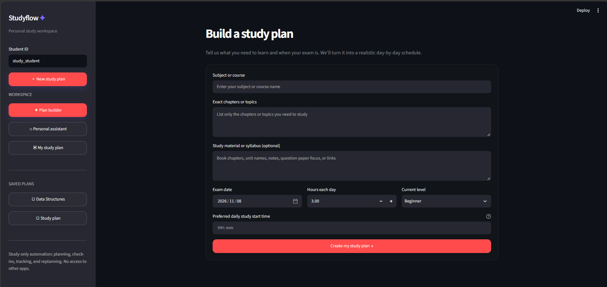
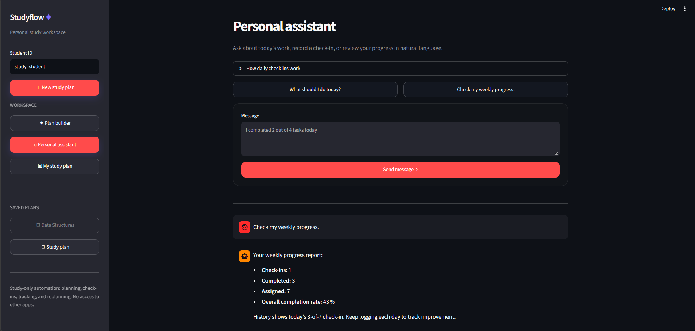
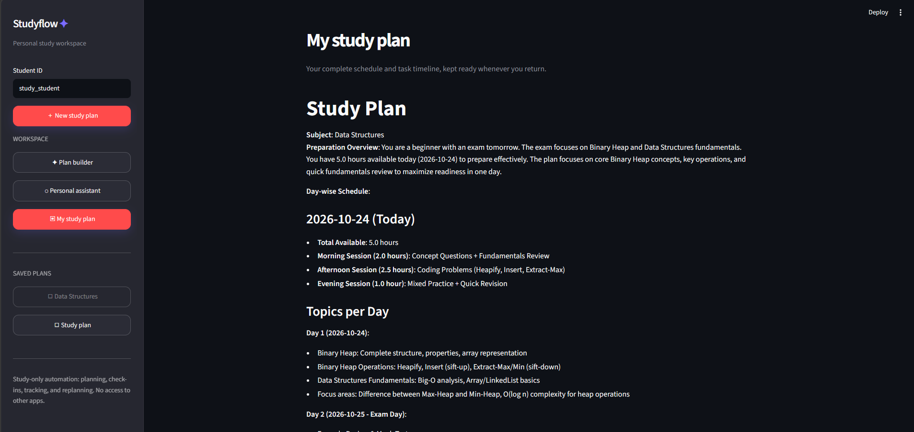
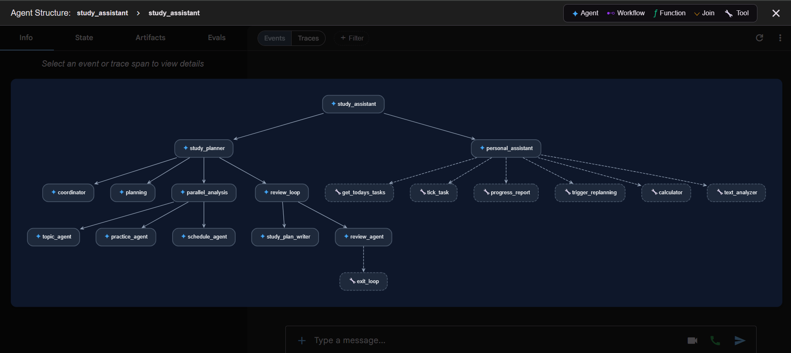

# Studyflow — Multi-Agent Study Assistant

Studyflow is a local Streamlit application that turns a student's exam details, topics, and available study time into a realistic day-by-day study plan. A personal assistant then helps the student follow that plan, record daily completion, monitor progress, and replan when they fall behind.

Built with **Google ADK**, **NVIDIA NIM via LiteLLM**, and **Streamlit**.

## Screenshots

### Plan builder



### Personal assistant



### Saved study plan



### Multi-agent architecture




## What it does

- Builds personalised study plans from a subject, exam date, topic list, study level, daily hours, and preferred start time.
- Uses a coordinator, planner, three parallel specialists, and a two-pass reviewer to create and check each plan.
- Shows today's study tasks, accepts natural-language completion check-ins, and summarises weekly progress.
- Rebuilds the remaining plan after two consecutive check-ins below 80% completion.
- Stores plans and progress locally in SQLite. It never accesses calendars, email, or other applications.

## Agent workflow

```text
study_assistant (router)
├── study_planner (SequentialAgent)
│   ├── coordinator → extracts requirements
│   ├── planning → prepares the specialist brief
│   ├── parallel_analysis (ParallelAgent)
│   │   ├── topic_agent → priority and difficulty
│   │   ├── practice_agent → practice activities
│   │   └── schedule_agent → daily time allocation
│   └── review_loop (LoopAgent, max 2 passes)
│       ├── study_plan_writer
│       └── review_agent → exit_loop when approved
└── personal_assistant
    ├── get_todays_tasks
    ├── tick_task
    ├── progress_report
    └── trigger_replanning
```

## Tech highlights

- Google ADK orchestration with `SequentialAgent`, `ParallelAgent`, and `LoopAgent`
- Shared state persisted across sessions with SQLite
- Deterministic tools for task extraction, progress tracking, and replanning
- Model and tool callbacks for local observability
- NVIDIA NIM model configured through LiteLLM with provider thinking disabled in the student interface
- Responsive Streamlit workspace with saved-plan history, plan builder, personal assistant, and timeline

## Quick start

**Prerequisites:** Python 3.11+ and an NVIDIA NIM API key.

```powershell
python -m venv .venv
.\.venv\Scripts\Activate.ps1
python -m pip install --upgrade pip
python -m pip install -r requirements.txt

```

Open `.env` and set your API key:

```
NVIDIA_API_KEY=Your_nvidia_nim_key
```

Run the app:

```powershell
python -m streamlit run streamlit_app.py
```


## How to use it

1. Open **Plan builder** and enter the subject, exact topics, exam date, daily study hours, and preferred study start time.
2. Select **Create my study plan**. The reviewed plan is saved locally.
3. Open **My study plan** to see the full schedule and task timeline.
4. Use **Personal assistant** to ask `What should I do today?` or `Check my weekly progress.`
5. At the end of a session, check in with a message such as: `I completed 3 out of 5 tasks today.`

## Local state

| State key | Purpose |
| --- | --- |
| `study_plan` | Reviewed plan and task manifest |
| `tasks_today` | Tasks extracted for the current day |
| `progress_log` | Daily completion check-ins |
| `user:student_level` | Student level remembered across sessions |
| `temp:missed_work` | Missed tasks used during replanning |

Runtime state, the virtual environment, API credentials, caches, and local SQLite data are ignored by Git.

## Tests

```powershell
python -m pytest -q
python -m compileall study_assistant streamlit_app.py
```

The test suite covers task-manifest parsing, daily task extraction, and the two-day replanning trigger without calling the model.

## Project structure

```text
study_assistant/
├── agent.py                # Agent graph and prompts
├── callbacks/              # Model and tool observability
├── state/                  # SQLite session service
└── tools/                  # Deterministic study tools
streamlit_app.py            # Streamlit workspace
tests/                      # Offline tests
```

## License

This project is available under the [MIT License](LICENSE).
